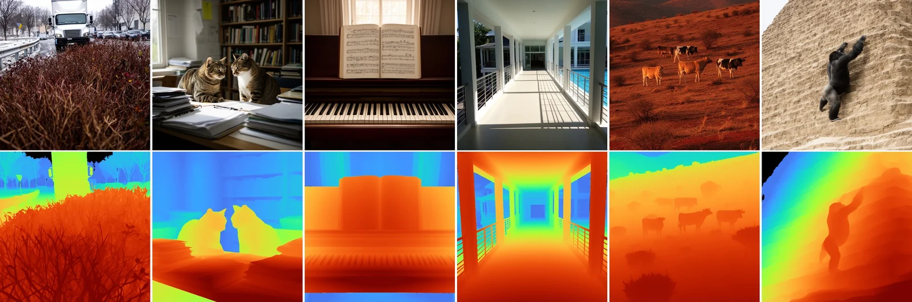
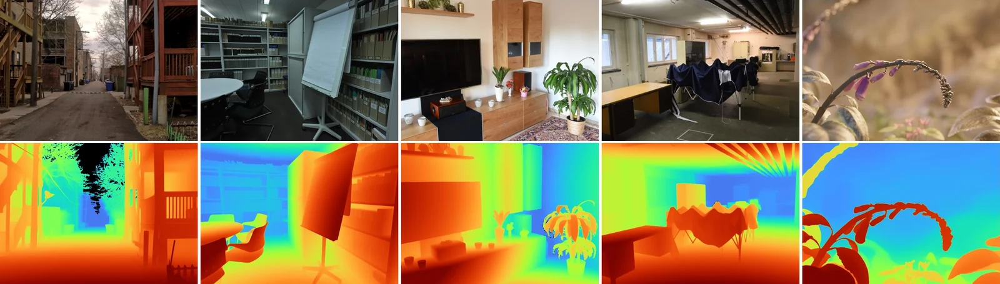
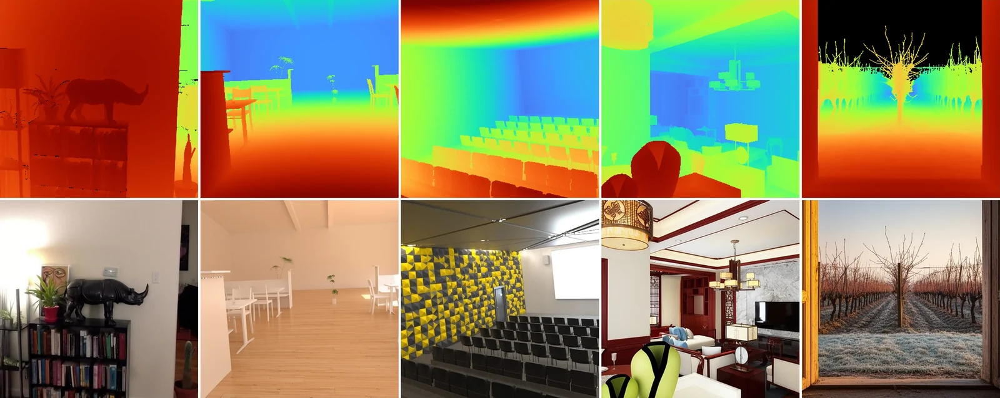
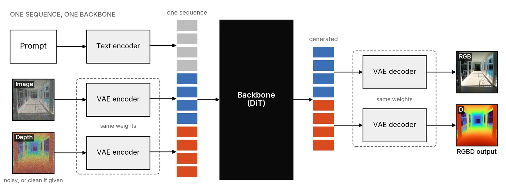
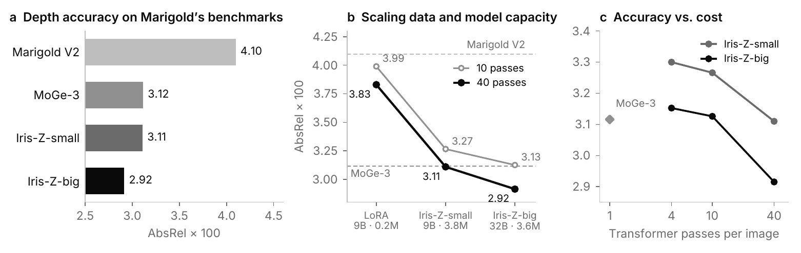

# Iris-Z

**One generative model for images and their depth**

Iris-Z is a general image generator that produces appearance and geometry together. The same weights
turn a prompt into an image, a prompt into an image with its depth, a photo into depth, and a depth map into an image.
On the standard depth benchmarks it is more accurate than the best specialist depth models, and it still generates
images like the model it started from.

<div align="center">

[](https://arxiv.org/abs/2611.16010)
[](https://speridlabs.com/research/iris-z)
[](https://huggingface.co/speridlabs/iris-z)
[](https://huggingface.co/spaces/speridlabs/iris-z)
[](https://www.python.org/downloads/)

</div>

<table>
<tr><th>Prompt → image + depth</th></tr>
<tr><td><picture></picture></td></tr>
<tr><th>Image → depth</th></tr>
<tr><td><picture></picture></td></tr>
<tr><th>Depth → image</th></tr>
<tr><td><picture></picture></td></tr>
</table>

## Model

<picture></picture>

| | Iris-Z-big | Iris-Z-small |
|---|---|---|
| Parameters | 32.2B | 9.1B |
| Resolution | 512 and 1024 | 512 and 1024 |
| Guidance | 3.5 | 4.0 |
| GPU memory, all tasks | ~112 GB | ~33 GB |
| Weights | `Iris-Z-big/` | `Iris-Z-small/` |

## Install

```bash
git clone https://github.com/speridlabs/iris-z-sdk.git
cd iris-z-sdk
uv sync                       # Python 3.10, PyTorch 2.9.1 (CUDA 13.0), an NVIDIA GPU
```

The weights are downloaded from Hugging Face on first use. Iris-Z also reads the FLUX.2 autoencoder, which is gated:
accept the terms of [black-forest-labs/FLUX.2-dev](https://huggingface.co/black-forest-labs/FLUX.2-dev) first, then
log in with `hf auth login`.

The PyTorch build is for CUDA 13.0, which needs an NVIDIA driver 580 or newer.

## Inference

```bash
uv run python -m iris_z.sample depth --image photo.jpg                       # image -> depth
uv run python -m iris_z.sample depth --image photos/ --model small           # a folder, with Iris-Z-small
uv run python -m iris_z.sample image --prompt "a lighthouse at dusk"         # prompt -> image
uv run python -m iris_z.sample rgbd  --prompt "a lighthouse at dusk"         # prompt -> image + depth
uv run python -m iris_z.sample paint --depth-map depth.png --prompt "a snowy village"   # depth -> image
```

Depth results are written as `<name>_depth.npy` (relative log depth), `<name>_depth.png` (coloured, near = red,
far = blue) and `<name>_input.png` (the image as the model saw it).

| flag | default | |
|---|---|---|
| `--model` | `big` | `big` (Iris-Z-big) or `small` (Iris-Z-small) |
| `--resolution` | auto | `512` or `1024`; depth auto = 512 for images under 0.5 MP, 1024 above |
| `--width`, `--height` | 1024 | generation size, multiples of 16 |
| `--steps` | 4 (depth), 50 (generation) | sampling steps |
| `--guidance` | 3.5 (big), 4.0 (small) | classifier-free guidance |
| `--seed` | 0 | just a seed 🌱! |
| `--depth-format` | `depth` | paint: `depth` (bright = far), `disparity` (bright = near) or `colours` (our colouring) |
| `--weights` | `speridlabs/iris-z` | a Hugging Face repo or a local folder |

### Python API

```python
from iris_z import IrisZPipeline

pipeline = IrisZPipeline.from_pretrained("speridlabs/iris-z", variant="big")

depth = pipeline.image_to_depth("photo.jpg")                    # DepthOutput
depth.colourized().save("photo_depth.png")
depth.log_depth, depth.sky_mask                                  # at the photo's own size
depth.log_depth_internal                                         # at the resolution the model worked at

image = pipeline.text_to_image("a lighthouse at dusk", width=1024, height=1024, seed=0)
rgbd = pipeline.text_to_rgbd("a lighthouse at dusk", seed=0)     # rgbd.image, rgbd.depth
painted = pipeline.depth_to_image(depth, prompt="the same street in winter")
```

Image → depth alone does not need the text encoder: `IrisZPipeline.from_pretrained(..., load_text_encoder=False)`
loads only the transformer and the autoencoder.

Ten seeds, the setting behind the benchmarks, run only in the image → depth pipeline (loaded without the text
encoder) and take the per-pixel median:

```python
depth_pipeline = IrisZPipeline.from_pretrained("speridlabs/iris-z", variant="big", load_text_encoder=False)
depth = depth_pipeline.image_to_depth("photo.jpg", seeds=range(10))
```

## Benchmark

AbsRel × 100, lower is better. Check the paper for more information.

<picture></picture>

**MoGe-3's benchmarks and protocol** (relative-error L1 alignment, seven of its nine sets):

| Model | NYUv2 | KITTI | ETH3D | iBims-1 | Sintel | HAMMER | DIODE | Mean |
|---|---|---|---|---|---|---|---|---|
| Depth Pro | 3.67 | 5.12 | 4.97 | 3.23 | 15.8 | 3.30 | 4.66 | 5.82 |
| InfiniDepth | 3.97 | 5.13 | 4.62 | 3.13 | 14.4 | 3.77 | 4.94 | 5.71 |
| Pixel-Perfect Depth | 3.29 | 4.66 | 3.27 | 2.94 | 14.1 | 2.99 | 3.95 | 5.03 |
| UniDepth V2 | 2.96 | 3.85 | 2.94 | 2.64 | 13.4 | 2.48 | 4.04 | 4.62 |
| UniK3D | 2.81 | 3.81 | 2.98 | 2.54 | 13.6 | 2.47 | 3.57 | 4.54 |
| MoGe-2 | 2.88 | 3.74 | 2.80 | 2.37 | 13.4 | 2.72 | 3.12 | 4.43 |
| MoGe-3 (paper) | 2.62 | 3.42 | 2.03 | 2.08 | 10.9 | 2.34 | **2.65** | 3.72 |
| Marigold V2 (our run) | 3.34 | 4.96 | 4.83 | 2.81 | 14.88 | 2.80 | 4.18 | 5.40 |
| MoGe-3 (our run) | 2.63 | 3.41 | 2.01 | 2.07 | 10.85 | 2.30 | **2.65** | 3.70 |
| Iris-Z-small | 2.40 | 3.53 | 2.18 | 2.20 | 11.50 | 2.22 | 2.88 | 3.84 |
| **Iris-Z-big** | **2.28** | **2.98** | **1.87** | **1.99** | **10.67** | **1.93** | 3.18 | **3.56** |

**Marigold V2's benchmarks and protocol** (RANSAC alignment in log depth):

| Model | NYUv2 | ETH3D | ScanNet | KITTI | DIODE | Mean |
|---|---|---|---|---|---|---|
| InfiniDepth | 4.3 | 6.1 | 4.7 | 8.7 | 6.4 | 6.04 |
| MoGe-2 | 3.1 | 5.0 | 3.1 | 6.9 | 9.6 | 5.54 |
| PPD (1024) | 4.1 | 4.3 | 4.6 | 7.0 | 6.8 | 5.36 |
| Lotus-2 | 3.7 | 4.1 | 4.0 | 6.7 | 6.5 | 5.00 |
| FE2E | 3.8 | 3.8 | 4.3 | 6.5 | 5.6 | 4.80 |
| Marigold V2 (paper) | 3.6 | 2.8 | 3.7 | 5.4 | 5.2 | 4.14 |
| π³ | 2.9 | 2.9 | 2.1† | 5.9 | 4.4 | 3.64† |
| Marigold V2 (our run) | 3.58 | 2.78 | 3.65 | 5.41 | 5.07 | 4.10 |
| MoGe-3 (our run) | 2.65 | 2.06 | 2.86 | **3.98** | **4.03** | 3.12 |
| Iris-Z-small | 2.07 | 2.12 | 2.56 | 4.58 | 4.22 | 3.11 |
| **Iris-Z-big** | **1.90** | **1.76** | **2.25** | 4.16 | 4.50 | **2.92** |

† π³ trains on ScanNet.

## Speed

One H200, SDK defaults (image → depth: one seed).

| Task | Method | Steps | Iris-Z-big 512 | Iris-Z-big 1024 | Iris-Z-small 512 | Iris-Z-small 1024 |
|---|---|---|---|---|---|---|
| Prompt → image | `text_to_image` | 50 | 33.2 s | 122.8 s | 10.2 s | 38.3 s |
| Prompt → image + depth | `text_to_rgbd` | 50 | 34.6 s | 128.2 s | 10.8 s | 40.3 s |
| Image → depth | `image_to_depth` | 4 | 1.44 s | 5.29 s | 0.52 s | 1.92 s |
| Depth → image | `depth_to_image` | 50 | 33.3 s | 123.0 s | 10.3 s | 38.5 s |

## License

The code is licensed under the [Apache License 2.0](LICENSE).

## Acknowledgements

Iris-Z builds on [FLUX.2](https://github.com/black-forest-labs/flux2) by Black Forest Labs.

**Made with ❤️ by [speridlabs.com](https://speridlabs.com)**
